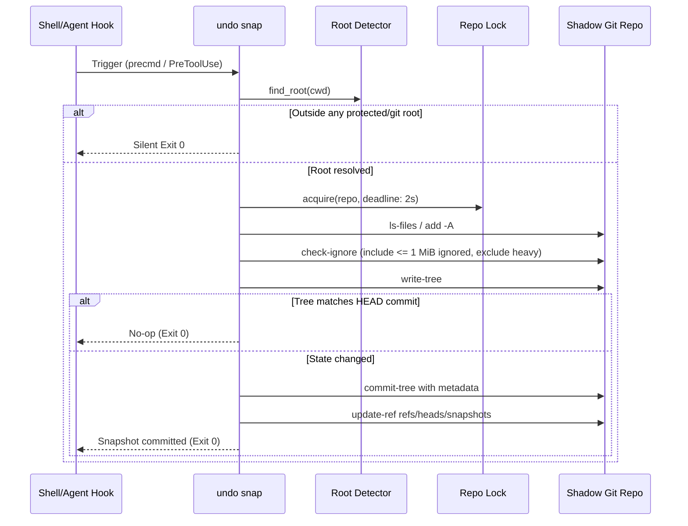
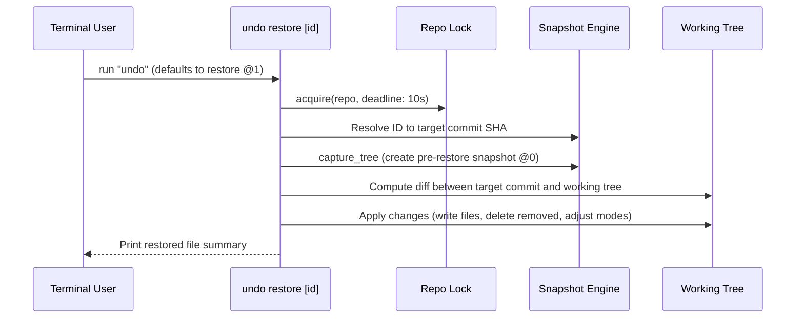

# Architecture & Technical Design

`undo` is a low-latency, zero-configuration local state recovery system for developers and autonomous AI coding agents. It provides a local "Ctrl-Z" safety net for accidental deletions, destructive terminal commands (`rm -rf`, `sed -i`), and unintended git operations (`git reset --hard`, `git clean -fd`).

---

## 1. Core Principles & Mental Model

1. **Isolation from Project Git State:**
   `undo` maintains an independent shadow Git repository under `~/.local/share/undo/repos/<hash>/`. It **never** writes to or alters the target repository's `.git/` directory, branch refs, index, or reflog.
2. **Deterministic Root Detection:**
   A project root is either the innermost enclosing Git repository or an explicitly protected directory configured via `undo protect`.
3. **Double-Safety on Restore:**
   Before any snapshot is restored into the working tree, `undo` captures an immediate pre-restore snapshot (`@0`). Any restore operation is itself reversible with another `undo`.
4. **Agent & Shell Native:**
   Automatic hooks integrate with interactive shells (`bash`, `zsh`, `fish`) via precmd/prompt hooks and with AI agent harnesses (Claude Code `PreToolUse` hook).

---

## 2. System Architecture & Components

```
                                +-------------------+
                                | CLI Entry Point   |
                                |   (main.rs)       |
                                +---------+---------+
                                          |
          +-------------------------------+-------------------------------+
          |                               |                               |
+---------v---------+           +---------v---------+           +---------v---------+
|  Root Detection   |           |    Paths & Lock   |           |     Git Runner    |
|   (root.rs)       |           | (paths.rs/lock.rs)|           |     (git.rs)      |
+---------+---------+           +---------+---------+           +---------+---------+
          |                               |                               |
          +-------------------------------+-------------------------------+
                                          |
    +-----------------+-------------------+-----------------+-----------------+
    |                 |                   |                 |                 |
+---v-----------+ +---v-----------+ +-----v---------+ +-----v---------+ +-----v---------+
| Snapshot      | | Restore Engine| | View Engine   | | Pruning Engine| | Hook Installer|
| (snapshot.rs) | | (restore.rs)  | | (view.rs)     | | (prune.rs)    | | (init.rs)     |
+---------------+ +---------------+ +---------------+ +---------------+ +---------------+
```

### Component Breakdown

| Module | File | Role & Invariants |
|---|---|---|
| **CLI Dispatch** | `src/main.rs` | Parses command-line arguments using `clap` derive. Maps default command (no arguments) to `undo` (restore `@1`). Formats errors as `undo: <msg>` and sets appropriate exit codes. |
| **Root Detection** | `src/root.rs` | Evaluates innermost enclosing root. Resolves Git roots using `git rev-parse --show-toplevel` and `--git-common-dir` to support worktrees. Reads protected roots from `~/.local/share/undo/roots`. Refuses `$HOME` without `--force`. |
| **Paths & Hashing** | `src/paths.rs` | Computes shadow repository directory as `~/.local/share/undo/repos/<sha256(canonical_root_path)>`. Ensures directory permissions are set strictly to `0700`. |
| **Concurrency Lock** | `src/lock.rs` | File lock mechanism on `<repo>/lock`. Uses polling with bounded timeouts (2 seconds for snapshots, 10 seconds for restore/pruning) to prevent concurrent shadow corruption. |
| **Git Runner** | `src/git.rs` | Invokes `git` subprocesses under strict isolation: overrides `GIT_DIR`, `GIT_WORK_TREE`, and `GIT_INDEX_FILE`. Disables system and global configs (`GIT_CONFIG_NOSYSTEM=1`, `GIT_CONFIG_GLOBAL=/dev/null`). Suppresses git attribute normalization by setting `core.attributesFile=/dev/null`. Enforces minimum Git version >= 2.25.0. |
| **Snapshot Engine** | `src/snapshot.rs` | Creates atomic commits in shadow repo. Stages tracked and untracked files. Preserves ignored files `<= 1 MiB` (e.g., `.env`) while excluding heavy dependencies (`node_modules`, `target`, build artifacts). Prunes nested git repository boundaries from the index to avoid corrupting submodules or nested clones. |
| **ID Resolution** | `src/ids.rs` | Maps human identifiers (`@0`, `@1`, `@N`), 40-character commit SHAs, and unique SHA prefixes to shadow commits. |
| **Restore Engine** | `src/restore.rs` | Restores working tree state to match snapshot. Captures pre-restore snapshot `@0`. Calculates additions, modifications, and deletions. Applies file write with conservative permissions (`0600` for files, `0700` for directories/executables). Leaves untouched files and nested repos unmodified. |
| **View Engine** | `src/view.rs` | Implements `undo list`, `undo diff`, and `undo status`. Formats relative timestamps (e.g., `42s ago`, `3m ago`) and parses snapshot commit headers. |
| **Pruning Engine** | `src/prune.rs` | Background lifecycle manager. Retains snapshots according to decay policy: keep all snapshots for 7 days, 1/hour for days 7–30, while observing storage capacity limits. |
| **Hook Manager** | `src/init.rs` | Installs shell integration scripts (`undo.bash`, `undo.zsh`, `undo.fish`) and injects the `PreToolUse` hook into `~/.claude/settings.json` with backup preservation. |
| **Logging** | `src/log.rs` | Non-panicking append logger for errors and warnings. Automatically truncates log files to 1 MiB while preserving recent history. |

---

## 3. Data Flow & Snapshot Lifecycle

### Capture Workflow (`undo snap`)



### Restore Workflow (`undo` / `undo restore <id>`)



---

## 4. Security & Safety Invariants

1. **Strict File Permissions:**
   Shadow repository directories and data files are created with mode `0700` (`rwx------`). Restored regular files inherit mode `0600` (`rw-------`) or `0700` if the executable bit was set in git tree index.
2. **Nested Repository Protection:**
   Nested git repositories within the project root are discovered and excluded from shadow gitlinks (`git rm --cached`). The restore process strictly avoids traversing or modifying files inside nested git repositories.
3. **Resource Bounding:**
   - Command timeouts: Watchdog monitors Git child processes and kills long-running calls exceeding deadlines.
   - Ignored file threshold: Ignored files larger than 1 MiB are excluded from snapshots.
   - Error log capping: Error logs are capped at 1 MiB with tail preservation.
   - Storage pruning: Background pruning cleans obsolete shadow commits automatically.
