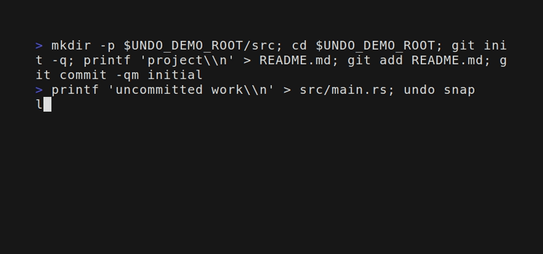

# undo

[](https://github.com/dpologdvinity/undo/actions/workflows/ci.yml)
[](https://github.com/dpologdvinity/undo/actions/workflows/release.yml)
[](https://github.com/dpologdvinity/undo/releases/latest)
[](https://crates.io/crates/undo-cli)
[](Cargo.toml)
[](#install)
[](https://github.com/dpologdvinity/homebrew-tap/blob/master/Formula/undo.rb)
[](#apt-debian-and-ubuntu)
[](#curl-linux-and-macos)
[](LICENSE)

**Ctrl-Z for your terminal and your AI agent.** `undo` saves a project's working tree after shell commands and before Claude Code tools. If `rm -rf src`, `git reset --hard`, or an agent command destroys uncommitted work, run `undo` to restore the last different snapshot.



## Install

Requires Linux or macOS and Git 2.25 or newer. WSL uses the Linux build.

### Homebrew

```sh
brew install dpologdvinity/tap/undo
```

Prebuilt binaries for x86_64 and aarch64 Linux and macOS are available on [GitHub Releases](https://github.com/dpologdvinity/undo/releases).

### curl (Linux and macOS)

```sh
curl --proto '=https' --tlsv1.2 -LsSf https://github.com/dpologdvinity/undo/releases/latest/download/undo-cli-installer.sh | sh
```

Installs to `~/.local/bin`. Follow the installer's output to update your shell's PATH if needed.

### apt (Debian and Ubuntu)

Supports Debian 12+, Ubuntu 22.04+, and compatible distributions with glibc 2.35+, on amd64 and arm64. Add the signed repository once:

```sh
sudo install -d -m 0755 /etc/apt/keyrings
curl -fsSL https://dpologdvinity.github.io/undo/apt/undo.asc | sudo tee /etc/apt/keyrings/undo.asc >/dev/null
sudo chmod 0644 /etc/apt/keyrings/undo.asc
echo "deb [arch=$(dpkg --print-architecture) signed-by=/etc/apt/keyrings/undo.asc] https://dpologdvinity.github.io/undo/apt stable main" | sudo tee /etc/apt/sources.list.d/undo.list
sudo apt update
sudo apt install undo
```

Signing-key fingerprint: `2302 833D 6799 6ED9 F4A7 E00F DAC0 6859 0999 DC8C`. The [public key](packaging/apt-key.asc) is scoped to this repository by `signed-by`. Future stable releases are available through normal apt upgrades.

### From source

Install the published release with Rust 1.89 or newer:

```sh
cargo install undo-cli --locked
```

For the latest source, install from `master` with Rust 1.89 or newer:

```sh
cargo install --git https://github.com/dpologdvinity/undo --branch master --locked undo-cli
```

From a local checkout, use `cargo install --path . --locked`.

## Set up

Git repositories are protected automatically. Add one of these to your shell startup file, then start a new shell:

```sh
# ~/.zshrc
eval "$(undo init zsh)"

# ~/.bashrc, if using Bash
eval "$(undo init bash)"

# ~/.config/fish/config.fish, if using fish
undo init fish | source
```

Each shell hook starts a background snapshot when the prompt returns. For Claude Code, run `undo init claude`. It merges a `PreToolUse` hook into `~/.claude/settings.json`, backs up the original, and does nothing on repeat. The hook snapshots synchronously before Bash, Write, Edit, and NotebookEdit tools.

For a directory outside Git, run `undo protect /path/to/project`; this creates its first snapshot. `undo unprotect /path/to/project` stops protection and prints the retained shadow repository's path.

## Use

```sh
undo                         # restore the newest different working tree; repeat to toggle back
undo list                    # snapshots, newest first
undo diff @1                 # preview restore direction
undo diff @1 --patch         # full patch
undo restore @3              # restore a chosen snapshot
undo restore @3 -- src/lib.rs # restore one path
undo snap                    # capture manually
undo status                  # protection, hooks, storage, limits, errors
undo prune                   # apply retention now
```

Snapshot IDs are `@N` (`@0` is newest) or unique commit prefixes of at least four hex characters. `undo restore` saves the current tree first, so it is reversible. It restores file contents, executable bits, and symlinks. Restored regular files are owner-readable and owner-writable; Git cannot record their original sharing permissions. It never restores Git refs, HEAD, commits, stashes, or the project's staging area.

## How it works

`undo` records trees and commits in a private bare Git repository under `~/.local/share/undo/repos/`, separate from the project. It reads the project's Git metadata but does not write its `.git`. Its own index tracks the working tree. Unchanged trees create no commit. Snapshots within the last seven days are retained; days 7–30 are thinned to one per hour. Older snapshots are removed, subject to a 2 GiB cap per root. `undo prune` applies these rules, and snapshots start a background prune at most daily.

| Recovery case | trash-cli | Claude Code `/rewind` | Git | undo |
|---|---|---|---|---|
| `rm -rf` | Only through `trash-put` | No for Bash | Only committed files | Yes, after a snapshot |
| `sed -i` | No | No for Bash | Only committed files | Yes, after a snapshot |
| `git reset --hard` | No | No for Bash | Commits via reflog; uncommitted edits lost | Working-tree edits, after a snapshot |
| `git clean -fdx` | No | No for Bash | Ignored/untracked files lost | Included files, after a snapshot |
| Agent Bash commands | No | No | Only committed files | Yes, with the Claude hook |

## Documentation

- [Architecture & Technical Design](ARCHITECTURE.md): Deep-dive into shadow git repositories, file permissions, concurrency locks, and data flows.
- [Contributing Guide](CONTRIBUTING.md): Local development setup, sandbox test harness guidelines, and pull request conventions.

## Limits and privacy

Snapshots stay local by default. They contain ignored files up to 1 MiB, including secrets such as `.env`; secure access to `~/.local/share/undo` accordingly. `undo` cannot recover:

- Commits, branches, or HEAD movement (use `git reflog`); the staging area; or stashes.
- Files outside protected roots, or work made and destroyed within a single long-running command.
- Heavy ignored directories (`node_modules`, `target`, `.venv`, `venv`, `dist`, `build`, `.next`, `.cache`, `__pycache__`), ignored files larger than 1 MiB, and nested Git repositories. Tracked files in a Git root remain protected even under those directory names.
- Work from before the first snapshot, or changes after the last snapshot when no hook ran.

A background shell snapshot can race with the next command if you start it immediately. The Claude hook completes before its tool call.

On WSL2 `/mnt/c` (DRVFS), a disposable repository with 10,001 small tracked files took 236.5 s to create, 826.7 s for the initial `git add`, and 240.0 s to commit. Its first `undo snap` exceeded the 10 s deadline. At this scale, the first snapshot can time out; use the WSL Linux filesystem for large repositories when timely snapshots matter.

## Uninstall

Remove the shell setup line and the `undo snap --trigger claude` entry from `~/.claude/settings.json` (the installer prints the backup path). Uninstall the binary with your package manager. Once you no longer need recovery, delete `~/.local/share/undo` yourself; deleting it discards every snapshot.
